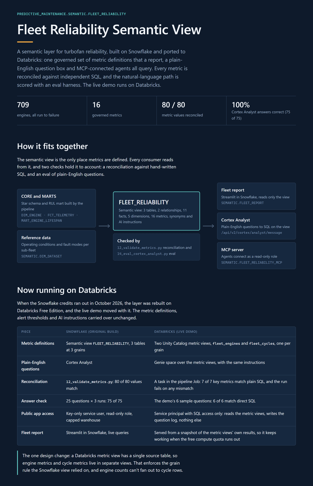

# Predictive Maintenance on a Governed Semantic Layer

Tandem XGBoost classifiers flag NASA C-MAPSS turbofan engines 50 and 15 cycles before failure, catching about 91% of failures on held-out engines. One Snowflake semantic view feeds a Streamlit report, Cortex Analyst and an MCP server under a read-only role, with all 80 metrics reconciled against hand-written SQL. The same pipeline runs on Databricks (a Unity Catalog feature table, MLflow champion models and the metric views behind a Genie space) and as a Kedro project that runs locally in 15 seconds.

**[Try it live: Ask the Fleet →](https://ask-the-fleet.streamlit.app)** Ask 709 engines a question in plain English, explore the fleet report, and tune the XGBoost and GNN models. No sign-in. Questions go to a Databricks Genie space over Unity Catalog metric views; the [guided tour of the semantic layer](https://claude.ai/artifact/Ai1U6EospZRsTgpSU9TxBL#tour) walks through the original Snowflake build.

## Results

Engines are split 60/20/20 into train, validation and test. Thresholds are chosen on validation engines to maximize F2 (recall weighted four times precision, because a missed failure costs far more than an early inspection); test engines are scored once.

| Model | Recall | Precision | F2 |
|-------|--------|-----------|----|
| Early Warning (≤ 50 cycles) | 0.917 | 0.679 | 0.857 |
| Critical Action (≤ 15 cycles) | 0.908 | 0.636 | 0.837 |

* **Class imbalance:** manual SMOTE, 6x undersampling and `scale_pos_weight` land within about 0.01 F2 of each other, so the simplest option (`scale_pos_weight`) is used.
* **Better inputs beat deep learning:** normalizing sensors within each operating condition and giving the model 14 sensors with 30 cycles of history lifts XGBoost to 0.931 F2. A graph neural network on the same inputs ties it ([below](#graph-neural-network-sensors-as-a-graph)).
* **The semantic layer is checked, not assumed:** 80 of 80 metrics reconcile with independent SQL, and Cortex Analyst scores 594/600 on 200 fresh questions.

The full experiment log is in [results.md](results.md).

## The Snowflake pipeline

Five schemas, each with one job:

1. **RAW:** space-delimited NASA logs loaded from an internal stage.
2. **STAGING:** typed columns named for physical components (High-Pressure Compressor Temperature, not `s3`), and an engine key that carries the dataset (`FD002_001`), since engine numbers restart in each of the four source files.
3. **CORE:** a star schema splitting static entities (`DIM_ENGINE`) from time-series events (`FCT_TELEMETRY`).
4. **MARTS:** the target, a piecewise-capped Remaining Useful Life (RUL), so healthy engines don't dominate training.
5. **FEATURE STORE:** 5-cycle rolling means and standard deviations computed with SQL window functions, in the warehouse.

The classifiers train in Snowpark and are versioned in Snowflake's Model Registry ([08_build_register_classifiers.ipynb](08_build_register_classifiers.ipynb)).

## Fleet reliability: Weibull model

The classifiers decide *which engine* to pull. [09_weibull_reliability_analysis.ipynb](09_weibull_reliability_analysis.ipynb) answers the fleet-planning questions: how long engines last, how failure risk grows with age, and when monitoring must be in place.

* **Wear-out failure:** Weibull shape β = 2.9–4.4 across datasets (β > 1 means risk rises with age). Characteristic life η ≈ 225 cycles (one fault mode) and ≈ 274 cycles (two fault modes); B10 life ≈ 135–140 cycles.
* **Fault modes matter, operating conditions don't:** log-rank tests show no lifetime difference across 1 vs. 6 operating conditions (p = 0.73–0.87), but engines with two fault modes live longer and less predictably (p < 0.001), so the fleet is planned as two populations.
* **Failure-free period:** no engine fails before about 125 cycles. A three-parameter Weibull captures this (AIC about 100 points lower) and shows a more gradual wear-out phase beyond it (β ≈ 1.6–1.8).
* **Censoring trap:** treating the truncated test engines as ordinary censored data overstates characteristic life by **5–15%**, because each trajectory was cut off at a random fraction of that engine's own life (censoring age correlates 0.56–0.88 with true life). A simulation confirms the mechanism: unbiased under independent censoring, biased when censoring tracks lifetime.
* **Age vs. sensors:** age alone flags engines within 50 cycles of failure with AUC 0.72–0.86 and misses remaining life by 33–55 cycles on average, which is why sensor-based condition monitoring drives individual removals and Weibull sets the fleet-level window.

## Semantic layer: governed fleet metrics

**[Take the tour →](https://claude.ai/artifact/Ai1U6EospZRsTgpSU9TxBL#tour)** A 10-step walk-through of the model, metrics, validation, Cortex Analyst eval and MCP server.

[](https://claude.ai/artifact/Ai1U6EospZRsTgpSU9TxBL)

[11_build_semantic_view.py](11_build_semantic_view.py) adds a `SEMANTIC` schema with a Snowflake semantic view, `FLEET_RELIABILITY`, so BI tools, Cortex Analyst and agents all read the same metric definitions instead of each re-deriving "mean time to failure" in their own SQL.

* **Three grains:** datasets (operating conditions and fault modes from NASA's readme), engines (one row per engine with its failure cycle), and cycles (`MART_ENGINE_LIFESPAN`). Each metric aggregates at its own grain, so engine counts never fan out to telemetry row counts.
* **Metrics:** engine count, mean/median/min/max time to failure and its spread, cycles flown, share of cycles in the early-warning and critical windows, average sensor readings, and HPC/LPT temperature rise from the first 20 cycles to the critical window.
* **Business logic from the deployed models:** the `health_stage` dimension uses the classifiers' horizons (RUL ≤ 50 early warning, ≤ 15 critical action), so a question asked in plain English uses the same definitions as the deployed models.
* **Context for natural-language queries:** synonyms (MTTF, T30, failure mode), descriptions with units, and SQL-generation instructions warning that raw sensor levels are not comparable across operating conditions.

| Operating conditions | Fault modes | Engines | MTTF (cycles) | Shortest life | HPC temp rise (°R) |
|---|---|---|---|---|---|
| Single | HPC | 100 | 206.3 | 128 | 13.7 |
| Single | HPC + fan | 100 | 247.2 | 145 | 15.6 |
| Six | HPC | 260 | 206.8 | 128 | 11.7 |
| Six | HPC + fan | 249 | 246.0 | 128 | 7.9 |

MTTF splits by fault mode, not by operating conditions, matching the Weibull log-rank results above.

**Checked, reported and served to agents:**
* **Reconciliation:** [12_validate_metrics.py](12_validate_metrics.py) recomputes every metric with hand-written SQL on STAGING, below anything the view reads. All 80 values (16 metrics × fleet and 4 datasets) match, a deliberate one-cycle threshold error is caught, and a Weibull fit lands within 0.6% of the view's MTTF. Exits non-zero on any mismatch.
* **Report:** [streamlit_app/fleet_report.py](streamlit_app/fleet_report.py) is a Streamlit in Snowflake app that reads only from the view. [13_deploy_fleet_report.py](13_deploy_fleet_report.py) runs every app query, filtered and unfiltered, before deploying.
* **Cortex Analyst eval:** [14_eval_cortex_analyst.py](14_eval_cortex_analyst.py) asks 25 questions 3 times each and scores the returned rows against independent SQL: 75/75 correct. The first pass found a real modeling flaw: a filter value of `'Single (sea level)'` that the model queried as `'Single'`. The fix went into the view. A second set of [200 new questions](cortex_analyst_eval_200/), with ground truth from `STAGING` rather than the view, scored 594/600 (99.0%) over 3 runs each. Most misses were Cortex returning both numbers in a comparison without subtracting them, fixed with one sentence in the view's instructions.
* **MCP server:** [15_create_mcp_server.py](15_create_mcp_server.py) creates a Snowflake-managed MCP server (Cortex Analyst on the view, plus SQL execution) and a read-only `FLEET_READER` role for clients. The test asks a question over MCP, runs the returned SQL, and confirms that a write through the SQL tool is refused.
* **Public demo, "Ask the Fleet":** [public_app/app.py](public_app/app.py), live at [ask-the-fleet.streamlit.app](https://ask-the-fleet.streamlit.app), is a Streamlit Community Cloud app where anyone can ask the fleet questions in plain English, plus the filterable fleet report. Questions go to a Databricks Genie space over the equivalent Unity Catalog metric views (see [Databricks port](#databricks-port-delta-mlflow-and-unity-catalog)). A question log enforces 50 questions a day (10 per visitor), and loading the page uses no compute: the log is read only when someone asks, so an open tab can't keep the SQL warehouse running. [16_setup_public_demo.py](16_setup_public_demo.py) is the Snowflake equivalent the demo ran on first: a key-only service user, a read-only role, an extra-small warehouse with a 30-second query limit and a monthly credit cap.
* **Modeling tab:** visitors pick XGBoost features and hyperparameters (trees, depth, learning rate) with radio buttons, or a GNN graph type, and see test F2, recall, precision, F2 at every threshold, the tuning landscape and feature importance. [17_build_model_explorer.py](17_build_model_explorer.py) trains all 54 XGBoost settings ahead of time with the same F2 protocol (threshold chosen on validation engines, test engines scored once), checks that the default settings reproduce the published scores, and packages the saved GNN results.

## Graph neural network: sensors as a graph

[10_sensor_graph_gnn.py](10_sensor_graph_gnn.py) treats each engine snapshot as a graph. The 14 informative sensors are nodes, each carrying its last 30 cycles of readings, normalized within its operating condition. A GRU encodes each sensor's history, two GATv2 attention layers pass messages between sensors, and a multitask head predicts RUL plus both maintenance flags. Same engine splits, same validation-tuned F2 thresholds, test engines scored once.

**Graph design.** Four edge sets, so the graph itself is tested rather than assumed:
* **Physics:** sensors on the same component, on adjacent gas-path stages (fan → LPC → HPC → combustor → HPT → LPT), on the same shaft, or linked by bleed flows
* **Correlation:** each sensor linked to its 3 most correlated sensors on training engines
* **Full:** every pair linked; attention must find the structure
* **None:** self-loops only, so no message passing (ablation)

Held-out test engines; GNN rows are mean ± std over 3 seeds:

| Model | Early Warning F2 | Critical Action F2 | RUL RMSE (cycles) |
|-------|------------------|--------------------|-------------------|
| XGBoost, original 8 features | 0.857 | 0.837 | n/a |
| XGBoost, same inputs as GNN (flattened) | **0.931** | 0.929 | **14.24** |
| GNN, no edges | 0.930 ± 0.002 | 0.933 ± 0.000 | 14.93 ± 0.10 |
| GNN, correlation graph | **0.931** ± 0.001 | 0.934 ± 0.001 | 14.37 ± 0.16 |
| GNN, physics graph | 0.930 ± 0.002 | 0.934 ± 0.002 | 14.30 ± 0.30 |
| GNN, fully connected | 0.929 ± 0.003 | **0.936** ± 0.003 | 14.61 ± 0.21 |

* **Better inputs did most of the work.** Normalizing sensors within each operating condition, using 14 sensors instead of 3, and giving the model 30 cycles of history lifts XGBoost from 0.857 to 0.931 F2 (Early Warning) and from 0.837 to 0.929 (Critical Action), with no deep learning at all.
* **The GNN ties a strong XGBoost; it does not beat it.** On identical inputs, the GNN matches Early Warning F2 and edges Critical Action by about 0.005 F2, trading some precision (0.79 vs 0.81) for recall (0.98 vs 0.96). RUL error is the same within noise (14.30 vs 14.24).
* **Message passing helps, if the graph is sparse.** Within the GNN, the correlation and physics graphs cut RUL error by about 0.6 cycles versus no edges, and every seed with a sparse graph beat every seed without one. The fully connected graph recovers only half of that gain. Physics and correlation graphs are tied within seed noise, so domain knowledge reproduced what the data already shows rather than adding to it.
* **Recommendation:** keep XGBoost (on the improved inputs) in production. It matches the GNN, trains in seconds rather than 10–15 minutes per run on CPU, and is easier to explain to maintenance engineers. A GNN would earn its complexity where the graph varies: fleets with different sensor sets per engine type, or localizing which component is failing.

**What attention learned.** As engines approach failure (RUL ≤ 15 vs. healthy), the physics GNN shifts attention toward two sensors as message sources: HPC static pressure (Ps30 → bleed enthalpy rises from 0.24 to 0.35; Ps30 → fuel flow ratio and HPC outlet temperature also rise) and LPT outlet temperature (T50 → fan speeds and coolant bleeds, 0.31–0.36 to 0.40–0.45). Both track high-pressure compressor degradation, the fault mode present in all four datasets. Attention weights indicate where the model looks, not proof of cause.

**NASA benchmark.** RMSE (cycles) on the official test trajectories, scored at each engine's last cycle against true RUL capped at 130. One model is trained on all four datasets pooled (425 engines), not tuned per dataset, and the official test set was never used for any choice.

| Model | FD001 | FD002 | FD003 | FD004 |
|-------|-------|-------|-------|-------|
| XGBoost, same inputs | **13.2** | **14.6** | 15.7 | 15.9 |
| GNN, no edges | 14.3 | 15.1 | 15.1 | 16.1 |
| GNN, physics graph | 14.8 | 15.1 | **14.8** | 15.3 |
| GNN, correlation graph | 14.8 | 15.3 | 15.2 | **15.2** |

[Raw results for every seed](gnn_results.json), including recall, precision, PR-AUC, thresholds and the NASA asymmetric score.

## Databricks port: Delta, MLflow and Unity Catalog

The same pipeline also runs on Databricks (serverless) as one Asset Bundle in [databricks/](databricks/). A five-task Job does the following:

1. **Ingest:** downloads the NASA archive into a Unity Catalog volume and loads the train and test files into bronze Delta tables.
2. **Transform:** rebuilds staging, core, marts and the feature store as Delta tables with Spark SQL window functions. The feature table has a `(engine_id, cycle TIMESERIES)` primary key, so it is a Unity Catalog feature table.
3. **Train and register:** for each classifier, compares class weighting, SMOTE and 6x undersampling as nested MLflow runs. The best validation F2 is registered in Unity Catalog with a `champion` alias. Each registered model is a pyfunc that carries its own validation-tuned threshold.
4. **Batch score:** loads both `@champion` models, scores the latest cycle of all 707 NASA test engines (histories cut off before failure) and writes `engine_risk_scores` with the tandem decision. NASA's true RUL for those engines is joined in for checking.
5. **Semantic layer:** rebuilds the `FLEET_RELIABILITY` semantic view as two Unity Catalog metric views. `fleet_engines` has one row per engine (MTTF, median, shortest and longest life). `fleet_cycles` has one row per engine per cycle (health stage, sensor averages, temperature rise to failure). Splitting by grain keeps engine metrics from fanning out to cycle rows. The task fails if any key metric disagrees with plain SQL on the tables.

The public **Ask the Fleet** app runs on this layer. Questions go to a Databricks Genie space over the metric views, carrying the Cortex Analyst instructions over unchanged. Genie runs its SQL as a service principal that can only read the metric views and write to the question log. The report tab is served from a snapshot of the metric views' own query results, so it uses no compute and keeps working when the Free Edition daily quota runs out. [setup_public_demo.py](databricks/setup_public_demo.py) creates the service principal, grants and Genie space, and [export_report_snapshot.py](databricks/export_report_snapshot.py) refreshes the snapshot.

Engine-level check on the NASA test engines, which played no part in training or model selection:

| Model | Recall | Precision |
|---|---|---|
| Early Warning (RUL ≤ 50) | 0.952 | 0.720 |
| Critical Action (RUL ≤ 15) | 0.912 | 0.689 |

| Action | Engines | Avg. true RUL | Truly ≤ 50 | Truly ≤ 15 |
|---|---|---|---|---|
| Immediate action required | 135 | 16.6 | 129 | 93 |
| Schedule maintenance | 169 | 54.4 | 90 | 9 |
| Normal operations | 403 | 114.5 | 11 | 0 |

The workspace host comes from the CLI profile, so log in once first:

```bash
cd databricks
databricks auth login --host <your workspace URL> --profile free
databricks bundle deploy --profile free
databricks bundle run cmapss_pipeline --profile free
```

## Kedro pipeline: local, modular, tracked with MLflow

[kedro/](kedro/) rebuilds the same transform → train → score job as a Kedro 1.7 project that runs locally in about 15 seconds. Each step is a pure function, the data flow is declared in a catalog, and every setting is in YAML parameters. One classifier pipeline is instantiated under two namespaces (`early_warning`, `critical_action`). [kedro-mlflow](https://github.com/Galileo-Galilei/kedro-mlflow) logs parameters, metrics and reports for each run. It also packages the scoring pipeline with both trained models as one registered MLflow model (`pipeline_ml_factory`). On the NASA test engines, Early Warning recall is 0.930 (95% Wilson interval 0.890–0.957) and Critical Action recall is 0.912 (0.841–0.953). Both intervals include the Databricks figures above. See its [README](kedro/README.md).

## Run it

```bash
pip install -r requirements.txt
python 01_fetch_data.py       # Download NASA C-MAPSS into data/raw
python evaluate_local.py      # Reproduce the feature store and models locally (no Snowflake needed)
jupyter notebook 09_weibull_reliability_analysis.ipynb   # Fleet reliability analysis
python 10_sensor_graph_gnn.py # GNN vs. XGBoost ablation (about 2.5 hours on 8 CPU cores; --quick for a 10-minute check)
pytest tests                  # Unit tests for windows, graphs and batching
```

To run the full Snowflake pipeline, set up [key-pair authentication](https://docs.snowflake.com/en/user-guide/key-pair-auth), put your account details in a `.env` file (with `SNOWFLAKE_PRIVATE_KEY_FILE` pointing at your private key), and run scripts `02` through `07` in order, then the `08` notebook in Snowflake. Then build and check the semantic layer with scripts `11` through `15`: `11` builds the view, `12` reconciles every metric against independent SQL (exits non-zero on any mismatch), `13` pre-flights and deploys the Streamlit report, `14` runs the Cortex Analyst eval, and `15` creates the read-only role and MCP server and tests them end to end.

## Stack and layout

Snowflake (SQL, Snowpark ML, Model Registry, semantic views, Cortex Analyst, MCP) · Databricks (Delta Lake, Unity Catalog, MLflow, Jobs, Asset Bundles, Genie) · Kedro and kedro-mlflow · XGBoost, scikit-learn, pandas · PyTorch and PyTorch Geometric (GATv2, GRU encoders) · lifelines and SciPy · Streamlit

```text
01–07_*.py                  Snowflake pipeline: fetch, stage, RAW → STAGING → CORE → MARTS → FEATURE STORE
08_*.ipynb, 09_*.ipynb      Tandem classifiers and Model Registry; Weibull fleet reliability
10_sensor_graph_gnn.py      Sensor-graph GNN vs. XGBoost ablation (gnn/ holds the windows, graphs and model)
11–15_*.py                  Semantic view, metric reconciliation, report deploy, Cortex Analyst eval, MCP server
16–17_*.py                  Public demo setup and the precomputed Modeling tab
databricks/                 Asset Bundle: ingest, transform, MLflow training, batch scoring, metric views, Genie demo
kedro/                      Kedro + kedro-mlflow version of transform, training and scoring
public_app/                 "Ask the Fleet" for Streamlit Community Cloud; streamlit_app/ is the Streamlit in Snowflake report
cortex_analyst_eval.json    Cortex Analyst eval: 25 questions × 3 runs, generated SQL and latencies
cortex_analyst_eval_200/    200 more questions with ground truth from STAGING, runner and results
results.md, gnn_results.json  Experiment log; per-seed GNN and baseline results
tests/                      Unit tests for the GNN data and model code
```

## License

Code: MIT ([LICENSE](LICENSE)). Data: NASA's C-MAPSS turbofan degradation dataset, from the Prognostics Center of Excellence data repository.
